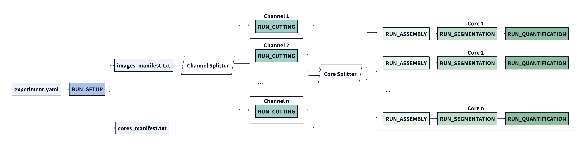

## PlexPipe-flow: Nextflow orchestration for PlexPipe

PlexPipe-flow runs the [PlexPipe](https://github.com/plexpipe/plex-pipe) multiplex imaging pipeline with [Nextflow](https://www.nextflow.io/), so that tissue microarrays and whole-slide images are processed in parallel, locally or on a Slurm cluster.

This repository contains only orchestration: Nextflow processes, resources and retries. Every process calls the `plexpipe` command that comes with the PlexPipe package (see [Command Line (plexpipe)](https://plexpipe.github.io/plex-pipe/latest/usage/cli/)), so the analysis code exists in one place only.

It manages:

- **Resource allocation**: the right CPU, memory and GPU for each step.
- **Data flow**: the outputs of one step become the inputs of the next.
- **Fault tolerance**: segmentation and quantification are retried (up to 3 times) with more resources.

The pipeline runs in two phases separated by a barrier:

- **Phase 1 – cutting**: one job per channel image cuts all ROIs from it.
- **Barrier**: `.collect()` waits until every channel has been cut.
- **Phase 2 – per ROI**: each ROI is assembled, segmented and quantified independently.



## Requirements

- Nextflow (Java 17 or newer).
- PlexPipe **0.1.0** installed in an environment the jobs can use, so that `plexpipe --version` works there:

  ```bash
  pip install "plex_pipe[all]==0.1.0"
  ```

  The first job checks the version and stops with a message if it differs (see `--plexpipe_version`).
- A PlexPipe config YAML with **absolute paths** (`general.image_dir`, `general.analysis_dir`, and any other path you set), and the ROIs already defined (`rois.pkl`).

## Quick start

Local run:

```bash
nextflow run main.nf -profile local \
    --exp_config /abs/path/to/config.yaml
```

Slurm cluster (adjust the `hpc` profile in `nextflow.config` to your cluster first):

```bash
nextflow run main.nf -profile hpc \
    --exp_config /abs/path/to/config.yaml \
    --plexpipe /abs/path/to/env/bin/plexpipe
```

With images on a remote Globus collection (see [Globus Setup](https://plexpipe.github.io/plex-pipe/latest/usage/globus/)):

```bash
nextflow run main.nf -profile hpc \
    --exp_config /abs/path/to/config.yaml \
    --globus_config /abs/path/to/globus_config.yaml \
    --cleanup
```

## Parameters

| Parameter | Default | Meaning |
|---|---|---|
| `--exp_config` | (required) | PlexPipe config YAML (absolute paths). |
| `--plexpipe` | `plexpipe` | The `plexpipe` command; give the full path if it is not on `PATH` in the jobs. |
| `--plexpipe_version` | `0.1.0` | PlexPipe version required; `''` skips the check (e.g. for a development install). |
| `--globus_config` | none | Globus config YAML; fetch the images from a remote collection. |
| `--from_collection` / `--to_collection` | `remote_source` / `local_workstation` | Collection keys in the Globus config. |
| `--file_checksum` | `false` | Transfer images that are already present too. |
| `--wait_hours` | `12` | How long a cutting job waits for its Globus transfer. |
| `--cleanup` | `false` | Delete each transferred image once it is cut. |
| `--roi_cleanup` | `false` | Delete each ROI's TIFFs once it is assembled. |
| `--overwrite` | `false` | Overwrite existing masks and tables. Retries always overwrite what the failed attempt wrote. |
| `--logdir` | `<launch dir>/pipeline_logs` | Nextflow timeline, report and trace. |

PlexPipe's own logs (one per job) are written to the analysis `logs` folder.

## Notes

- **Cutting jobs are not retried.** With `--cleanup`, the transferred image is deleted after cutting, so a retry would have no input.
- **`-resume` and the analysis folder.** PlexPipe writes the ROI stores in place in the analysis folder, and the processes pass their paths as values. `-resume` therefore re-runs a step only when its inputs (config, ROI list) change, not when the files in the analysis folder changed. To redo steps, use `--overwrite`, or run single ROIs with `plexpipe` directly.
